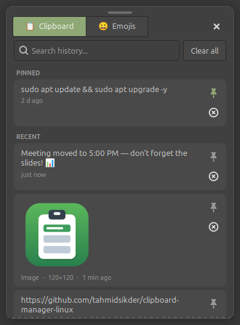
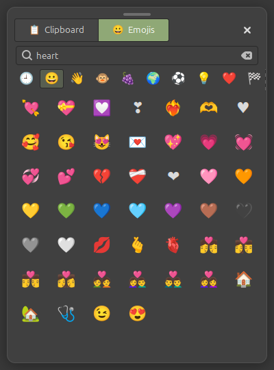

<p align="center">
  
</p>

<h1 align="center">ClipBoard: Windows 11 style clipboard manager for Linux Mint</h1>

<p align="center">
  <b>Press <kbd>Super</kbd> + <kbd>V</kbd> on Linux, just like <kbd>Win</kbd> + <kbd>V</kbd> on Windows 11.</b><br>
  Clipboard history · click to paste · pinned favorites · emoji picker · drag &amp; drop
</p>

<p align="center">
  <a href="https://github.com/tahmidsikder/clipboard-manager-linux/releases/latest/download/ClipBoard-Linux.zip"></a>
</p>

<p align="center">
  
  
  
  
</p>

<p align="center">
  
  &nbsp;&nbsp;
  
</p>

If you moved from Windows and miss the **Win + V clipboard history**, this is for you.
ClipBoard is a small, free clipboard manager for **Linux Mint (Cinnamon)** that remembers
everything you copy (text, links, code, images and screenshots) and pastes it back with one click.

**No sudo, no extra packages, no account, no internet.** It installs in a few seconds and only for your user.

## ✨ Features

| | |
|---|---|
| ⌨️ **Super + V anywhere** | Opens the clipboard popup next to your mouse, in any app. |
| 📋 **Clipboard history** | Keeps your last 50 copies: text, links, code, images and screenshots. |
| 🖱️ **Click to paste** | Click an item and it is pasted straight into the app you were using. Terminals get <kbd>Ctrl</kbd>+<kbd>Shift</kbd>+<kbd>V</kbd> automatically. |
| 📌 **Pin favorites** | Pinned items stay at the top and are kept across reboots. |
| 😀 **Emoji picker** | 1,900+ emojis. Search by keyword (`love`, `lol`, `fire`, `pizza`) or browse categories. Pasting an emoji keeps your copied text. |
| 🔍 **Search** | Just start typing to filter your history. |
| 🖼️ **Drag & drop** | Drag images or text into other apps or the file manager. |
| ⌨️ **Keyboard friendly** | <kbd>↑</kbd> <kbd>↓</kbd> to choose, <kbd>Enter</kbd> to paste, <kbd>Delete</kbd> to remove, <kbd>Esc</kbd> to close. |
| 🔒 **Private** | Everything stays on your computer. Copies that password managers mark as secret are skipped. |
| 🎨 **Matches your theme** | Follows your Linux Mint light/dark theme. Has a tray icon and starts at login. |

## 🚀 Install

### Option 1: One command (easiest)

Open a terminal (<kbd>Ctrl</kbd>+<kbd>Alt</kbd>+<kbd>T</kbd>), paste this and press Enter:

```bash
wget -qO- https://github.com/tahmidsikder/clipboard-manager-linux/archive/refs/heads/main.tar.gz | tar xz -C /tmp && bash /tmp/clipboard-manager-linux-main/install.sh
```

### Option 2: Download the ZIP

1. **[⬇ Download ClipBoard-Linux.zip](https://github.com/tahmidsikder/clipboard-manager-linux/releases/latest/download/ClipBoard-Linux.zip)**
2. Right-click the zip and choose **Extract Here**.
3. Right-click the extracted `clipboard-linux` folder, choose **Open in Terminal**, and run:
   ```bash
   bash install.sh
   ```

That's it. Press **<kbd>Super</kbd> + <kbd>V</kbd>** (the Windows key + V) to open it.

> Want a different shortcut? Run `bash install.sh '<Alt>v'`, or change it any time in
> **System Settings → Keyboard → Shortcuts → Custom Shortcuts → ClipBoard**.

## 🧩 Requirements

- **Linux Mint 21 / 22 Cinnamon** (tested on Linux Mint 22.3).
- An **X11** session (the default on Linux Mint).
- Python 3 + GTK 3, which are already installed on Linux Mint.

Other X11 desktops such as Ubuntu (Xorg), MATE and Xfce should work too. The shortcut is only set
automatically on Cinnamon, so on other desktops add a custom shortcut that runs `~/.local/bin/clipboard-linux --toggle`.

## 🗑️ Uninstall

```bash
bash ~/.local/share/clipboard-linux/app/uninstall.sh
```

Add `--purge` to also delete your pinned items.

## ❓ FAQ

**Does it send my data anywhere?**
No. It never connects to the internet. History lives in memory, and only items you pin are saved, in `~/.local/share/clipboard-linux`.

**Where is it installed?**
In your home folder only: `~/.local/share/clipboard-linux`, `~/.local/bin/clipboard-linux`, a menu entry and an autostart entry.

**Super + V does nothing.**
Make sure ClipBoard is running (look for the tray icon, or open it from the menu), and check that
no other shortcut uses Super + V in **Keyboard → Shortcuts**.

**Does it work on Wayland?**
Not yet. Auto-paste needs X11.

## 🇧🇩 বাংলায় নির্দেশিকা

**ইন্সটল:** Terminal খুলুন (<kbd>Ctrl</kbd>+<kbd>Alt</kbd>+<kbd>T</kbd>), উপরের "One command" লাইনটি পেস্ট করে Enter চাপুন।
অথবা ZIP ডাউনলোড করে Extract করুন, ফোল্ডারে Right-click → **Open in Terminal** → `bash install.sh`।

**ব্যবহার:**
- যেকোনো অ্যাপে **Super + V** (Windows কী + V) চাপুন।
- টেক্সট, ছবি বা ইমোজিতে ক্লিক করলেই পেস্ট হয়ে যাবে।
- পিন আইকনে ক্লিক করে দরকারি আইটেম স্থায়ীভাবে সেভ রাখুন।
- "Emojis" ট্যাবে ইংরেজি নাম লিখে (love, lol, fire) ইমোজি খুঁজুন।
- কোনো sudo, পাসওয়ার্ড বা ইন্টারনেট লাগবে না।

## ⭐ Support

If ClipBoard saves you time, please **star this repo** ⭐ and share it with other Linux Mint users.
Found a bug or have an idea? [Open an issue](https://github.com/tahmidsikder/clipboard-manager-linux/issues).

## 📄 License

[MIT](LICENSE) © Tahmid Sikder Rifat
